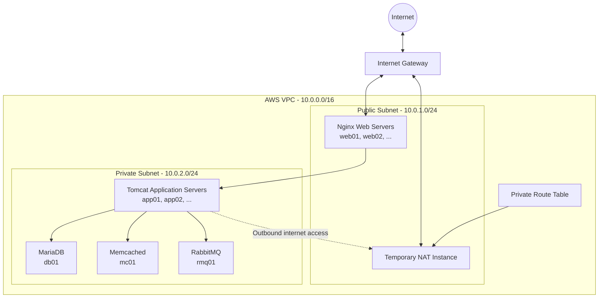

# Multi-Tier Java Application Infrastructure on AWS

<p align="center">
  <strong>Infrastructure as Code • AWS • Terraform • Linux • Networking • DevOps</strong>
</p>

<p align="center">
  
  
  
  
</p>

## Overview

This project provisions the infrastructure for a multi-tier Java web application on **Amazon Web Services (AWS)** using **Terraform**.

The infrastructure follows a traditional enterprise-style architecture, separating web, application, and backend services into dedicated server tiers. Terraform automates the creation and management of AWS resources, making the infrastructure repeatable, configurable, and easier to maintain.

The project focuses on practical cloud infrastructure engineering, including network segmentation, security group configuration, EC2 provisioning, scalable server groups, and controlled internet access for private instances.

## Architecture

The infrastructure is deployed inside a custom AWS Virtual Private Cloud (VPC), divided into public and private subnets.



### Infrastructure Components

| Component | Technology | Deployment |
|---|---|---|
| Cloud provider | AWS | Cloud infrastructure |
| Infrastructure automation | Terraform | Resource provisioning |
| Virtual network | Amazon VPC | Custom network |
| Public access | Internet Gateway | Public subnet |
| Web tier | Nginx | Public EC2 instances |
| Application tier | Apache Tomcat | Private EC2 instances |
| Database | MariaDB | Private EC2 instance |
| Caching | Memcached | Private EC2 instance |
| Message broker | RabbitMQ | Private EC2 instance |
| Temporary internet access | NAT Instance | Public EC2 instance |
| Operating system | Ubuntu 22.04 LTS | EC2 instances |
| Storage | Amazon EBS gp3 | Encrypted root volumes |

## Network Design

The project uses a custom VPC with the following network configuration:

| Network Component | CIDR |
|---|---|
| VPC | `10.0.0.0/16` |
| Public Subnet | `10.0.1.0/24` |
| Private Subnet | `10.0.2.0/24` |
| Availability Zone | `eu-north-1a` |

### Public Subnet

The public subnet hosts the Nginx web servers and the temporary NAT instance.

It uses an Internet Gateway and a public route table to provide internet connectivity.

### Private Subnet

The private subnet hosts the application and backend services.

Instances in this subnet do not receive public IP addresses and are not directly accessible from the internet.

A separate private route table can direct outbound internet traffic through the temporary NAT instance.

## Security Architecture

Security groups are assigned according to the role of each server.

| Security Group | Allowed inbound traffic | Source |
|---|---|---|
| Web | TCP 80, 443 | Internet |
| Web | TCP 22 | Administrator IP |
| Application | TCP 8080 | Web security group |
| Application | TCP 22 | Web security group |
| Database | TCP 3306 | Application security group |
| Memcached | TCP 11211 | Application security group |
| RabbitMQ | TCP 5672 | Application security group |

Additional SSH rules allow administration of private instances through the web servers using the bastion approach.

All server security groups currently allow outbound traffic. This simplifies package installation and communication during the lab deployment; outbound access can be restricted further in a hardened production environment.

## Scalability

Terraform uses `for_each` to create server instances dynamically.

The project supports independent scaling of the web and application tiers.

### Web Tier

Controlled by:

```hcl
web_instance_count = 1
```

For example, setting the value to `2` creates:

- web01
- web02

### Application Tier

Controlled by:

```hcl
app_instance_count = 1
```

For example, setting the value to `3` creates:

- app01
- app02
- app03

Both variables support values between 1 and 5.

### Fixed Backend Services

The following backend servers remain single instances:

- db01 — MariaDB
- mc01 — Memcached
- rmq01 — RabbitMQ

This keeps the architecture straightforward while allowing the web and application layers to scale independently.

## Temporary NAT Instance

A NAT instance is used to provide temporary outbound internet connectivity to the private subnet.

This is useful during initial provisioning for:

- Installing Linux packages.
- Downloading application dependencies.
- Installing and configuring backend services.
- Updating operating system packages.

The NAT instance is controlled by a Terraform variable:

```hcl
enable_nat_instance = true
```

After initial provisioning and verification, it can be disabled:

```hcl
enable_nat_instance = false
```

Terraform then removes the NAT instance and its private default route.

**Important:** Private instances will lose general internet access after NAT removal. Any future maintenance or management requiring internet connectivity needs an alternative connectivity solution.

## Terraform Project Structure

```text
multi-tier-java-aws/
│
├── terraform/
│   ├── provider.tf
│   ├── main.tf
│   ├── variables.tf
│   ├── terraform.tfvars
│   ├── networking.tf
│   ├── security_groups.tf
│   ├── egress_rules.tf
│   ├── ec2.tf
│   ├── nat.tf
│   ├── outputs.tf
│   └── .terraform.lock.hcl
│
├── scripts/
│   └──
│
├── docs/
│   └──
│
├── .gitignore
└── README.md
```

Terraform state files, plans, credentials, and local configuration files are excluded from version control.

## Prerequisites

Before deploying the infrastructure, make sure you have:

- An AWS account.
- AWS CLI installed and configured.
- Terraform installed.
- Git installed.
- An existing EC2 key pair in the selected AWS region.
- Your public IP address in CIDR notation.

The default deployment region is:

```hcl
aws_region = "eu-north-1"
```

## Deployment Guide

### 1. Clone the repository

```bash
git clone https://github.com/mh-power2/vprofile-multi-tier-aws-terraform.git

cd vprofile-multi-tier-aws-terraform/terraform
```

### 2. Configure AWS credentials

Authenticate using your configured AWS CLI authentication method.

Verify your identity:

```bash
aws sts get-caller-identity
```

### 3. Configure Terraform variables

Create or update your local `terraform.tfvars` file:

```hcl
admin_cidr   = "YOUR_PUBLIC_IP/32"
aws_region   = "eu-north-1"
project_name = "vprofile-aws"
ec2_key_name = "vprofile-key"

web_instance_count = 1
app_instance_count = 1

enable_nat_instance = true
```

Use an existing EC2 key pair name and your actual public IP address.

### 4. Initialize Terraform

```bash
terraform init
```

### 5. Format Terraform files

```bash
terraform fmt -recursive
```

### 6. Validate configuration

```bash
terraform validate
```

### 7. Review the execution plan

```bash
terraform plan
```

### 8. Deploy the infrastructure

```bash
terraform apply
```

Review the execution plan and confirm the deployment when prompted.

### 9. Retrieve infrastructure outputs

```bash
terraform output
```

Terraform displays the VPC ID, subnet IDs, EC2 instance IDs, and server IP addresses.

## Infrastructure Scaling

To increase the number of web or application servers, update the corresponding variables in `terraform.tfvars`.

For example:

```hcl
web_instance_count = 2
app_instance_count = 3
```

Then execute:

```bash
terraform plan
terraform apply
```

Terraform will reconcile the infrastructure with the updated desired configuration.

## Resource Cleanup

This project is designed for a temporary lab environment, so resources should be destroyed when they are no longer needed.

Run:

```bash
terraform destroy
```

Review the destruction plan before confirming.

This removes the Terraform-managed infrastructure and helps prevent unnecessary AWS charges.

## Security and Best Practices

The project incorporates several infrastructure security practices:

- Public and private network segmentation.
- Security groups with tier-specific inbound access.
- Restricted SSH access through the administrator IP and web-tier bastion.
- No public IP addresses on private instances.
- Encrypted EBS root volumes using gp3.
- IMDSv2 enforced for EC2 metadata access.
- Sensitive Terraform files excluded from Git.
- Infrastructure managed declaratively through Terraform.

For production environments, additional improvements would include centralized secrets management, tighter outbound rules, high availability across Availability Zones, TLS certificate management, centralized monitoring, and automated backup strategies.

## Learning Outcomes

This project provides hands-on experience with:

- AWS cloud infrastructure.
- Infrastructure as Code using Terraform.
- VPC, subnet, route table, and Internet Gateway configuration.
- Public and private network architecture.
- EC2 provisioning and instance management.
- Linux server infrastructure.
- Security groups and network access control.
- NAT instance configuration and IP forwarding.
- Terraform variables, locals, loops, and `for_each`.
- Infrastructure scaling and lifecycle management.
- Git and GitHub project management.

## Future Improvements

Potential extensions to this project include:

- Automated server provisioning using Bash or Ansible.
- Application deployment automation.
- CI/CD integration using Jenkins.
- Centralized monitoring with Prometheus and Grafana.
- Infrastructure deployment across multiple Availability Zones.
- Improved secrets and configuration management.

## Author

**Mohamed Hassan**

Cloud Infrastructure | DevOps | Linux | AWS | Terraform

GitHub: [mh-power2](https://github.com/mh-power2)

---

<p align="center">
  <strong>Built with Terraform and AWS</strong><br>
  Infrastructure as Code • Automation • Scalability • Security
</p>
