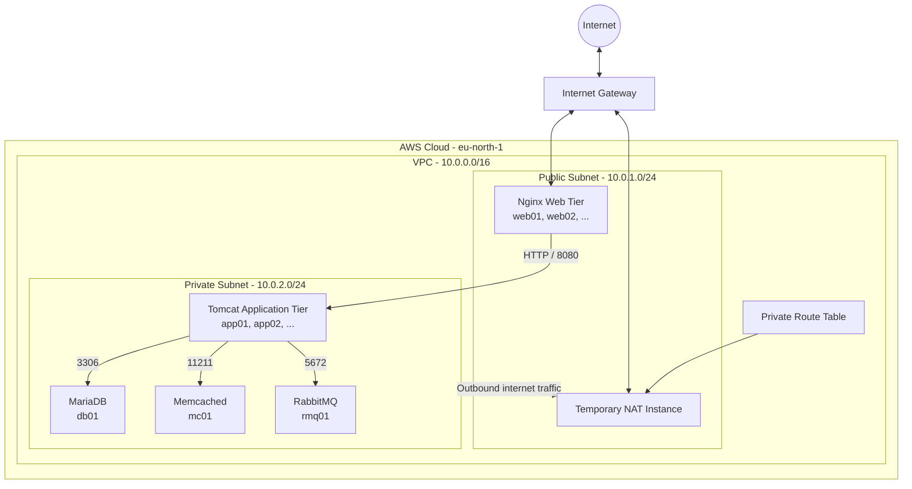
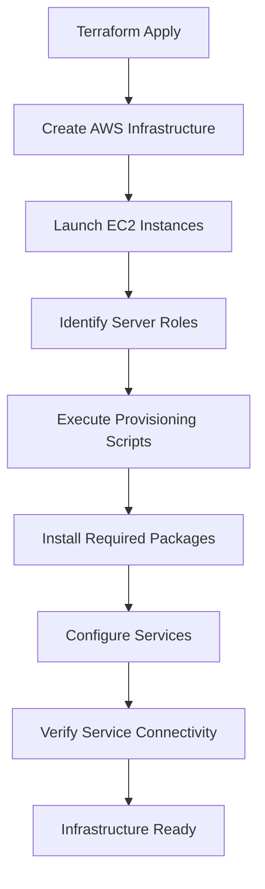

# Multi-Tier Java Application Infrastructure on AWS

<p align="center">
  <strong>Infrastructure as Code | Cloud Engineering | Automation | Scalability</strong>
</p>

<p align="center">
  
  
  
  
  
</p>

## Project Overview

This project demonstrates the provisioning and management of a multi-tier Java application infrastructure on **Amazon Web Services (AWS)** using **Terraform**.

The infrastructure follows a traditional enterprise architecture, separating web servers, application servers, and backend services into dedicated network and compute tiers.

The primary objective is to build a reusable and configurable cloud environment using Infrastructure as Code (IaC), while applying practical DevOps and cloud engineering principles.

Instead of manually creating and configuring AWS resources, Terraform manages the infrastructure declaratively, allowing resources to be provisioned, modified, scaled, and destroyed consistently.

The project also incorporates reusable server provisioning scripts to support repeatable configuration whenever infrastructure is recreated or additional instances are introduced.

### Project Goals

- Build AWS infrastructure using Terraform.
- Implement public and private network segmentation.
- Deploy a multi-tier application architecture.
- Configure secure communication between application tiers.
- Support independent scaling of web and application servers.
- Automate server provisioning using reusable scripts.
- Implement temporary internet connectivity for private instances.
- Follow infrastructure security and cost-management practices.
- Maintain a clean and reusable GitHub project structure.

---

## Architecture

The infrastructure is deployed inside a custom Amazon VPC containing a public subnet and a private subnet.

The web tier is exposed to internet traffic, while application and backend servers remain in the private network.

### Architecture Diagram



### Infrastructure Components

| Component | Technology | Purpose |
|---|---|---|
| Cloud Provider | AWS | Cloud infrastructure |
| Infrastructure as Code | Terraform | Automated resource provisioning |
| Virtual Network | Amazon VPC | Network isolation |
| Internet Connectivity | Internet Gateway | Public subnet connectivity |
| Web Tier | Nginx | Web traffic handling |
| Application Tier | Apache Tomcat | Java application runtime |
| Database | MariaDB | Relational data storage |
| Caching | Memcached | In-memory caching |
| Message Broker | RabbitMQ | Asynchronous messaging |
| Temporary NAT | NAT EC2 Instance | Private subnet outbound connectivity |
| Operating System | Ubuntu 22.04 LTS | Server operating system |
| Storage | Amazon EBS gp3 | Persistent EC2 root volumes |

---

## Network Architecture

The project uses a custom VPC with separate public and private subnets.

### VPC Configuration

| Network Component | Configuration |
|---|---|
| VPC CIDR | `10.0.0.0/16` |
| Public Subnet | `10.0.1.0/24` |
| Private Subnet | `10.0.2.0/24` |
| Availability Zone | `eu-north-1a` |
| AWS Region | `eu-north-1` |

### Public Subnet

The public subnet hosts:

- Nginx web servers.
- Temporary NAT instance.

It is connected to the Internet Gateway through a public route table.

Web instances receive public IP addresses and can serve incoming HTTP and HTTPS requests.

### Private Subnet

The private subnet hosts:

- Tomcat application servers.
- MariaDB.
- Memcached.
- RabbitMQ.

Private instances do not receive public IP addresses and cannot be directly accessed from the internet.

Their network access is controlled through security groups and the private route table.

### Network Routing

**Public route table:**

| Destination | Target |
|---|---|
| VPC CIDR | Local |
| `0.0.0.0/0` | Internet Gateway |

**Private route table:**

| Destination | Target |
|---|---|
| VPC CIDR | Local |
| `0.0.0.0/0` | NAT instance, when enabled |

---

## Security Architecture

Security groups control communication between the different infrastructure tiers.

Each server group has a dedicated security group, following the principle of allowing only the required inbound connections.

### Security Group Rules

| Security Group | Port | Protocol | Allowed Source |
|---|---:|---|---|
| Web | 80 | TCP | Internet |
| Web | 443 | TCP | Internet |
| Web | 22 | TCP | Administrator IP |
| Application | 8080 | TCP | Web Security Group |
| Application | 22 | TCP | Web Security Group |
| Database | 3306 | TCP | Application Security Group |
| Memcached | 11211 | TCP | Application Security Group |
| RabbitMQ | 5672 | TCP | Application Security Group |

SSH access to private servers follows a bastion-host approach through the web tier.

All five server security groups currently allow outbound traffic. This keeps initial provisioning and service communication straightforward. Restricting outbound traffic further is a potential security improvement.

### Additional Security Measures

- Private instances do not receive public IP addresses.
- SSH access to web servers is restricted to the administrator's public IP.
- Private server SSH access is restricted to the web security group.
- EBS root volumes use encryption.
- IMDSv2 is enforced for EC2 instance metadata.
- Sensitive Terraform files and private keys are excluded from Git.
- Infrastructure access is controlled using AWS security groups.

---

## Infrastructure Scaling

Terraform dynamically creates EC2 instances using `for_each` and configurable variables.

The web and application tiers can scale independently without manually defining every EC2 resource.

### 1. Web Tier — Nginx

Controlled through:

```hcl
web_instance_count = 1
```

Increasing the value to `2` creates:

```text
web01
web02
```

### 2. Application Tier — Tomcat

Controlled through:

```hcl
app_instance_count = 1
```

Increasing the value to `3` creates:

```text
app01
app02
app03
```

Both variables support values between 1 and 5.

### 3. Fixed Backend Services

The backend services remain single instances:

| Instance | Service | Role |
|---|---|---|
| db01 | MariaDB | Database |
| mc01 | Memcached | Caching |
| rmq01 | RabbitMQ | Message Broker |

This design keeps the backend architecture straightforward while allowing the web and application tiers to scale independently.

**Note:** Terraform instance scaling creates additional EC2 instances. Application-level load balancing, service discovery, and configuration distribution between multiple instances require additional implementation.

---

## Temporary NAT Instance

A NAT instance provides outbound internet connectivity to instances in the private subnet during initial provisioning.

This avoids deploying an AWS NAT Gateway for this cost-conscious lab environment.

### Why use a NAT instance?

Private servers may need internet access for:

- Installing Linux packages.
- Downloading application dependencies.
- Installing Java and Tomcat.
- Installing MariaDB, Memcached, and RabbitMQ.
- Updating Ubuntu packages.

### NAT Configuration

The NAT instance is deployed in the public subnet.

It uses:

- An EC2 security group allowing HTTP and HTTPS forwarding from the private subnet.
- Disabled source/destination checking.
- Linux IP forwarding.
- IPTables masquerading.
- A private route table pointing internet-bound traffic to the NAT instance.

The NAT instance is controlled using:

```hcl
enable_nat_instance = true
```

After provisioning and verifying that the application no longer requires general internet access, it can be disabled:

```hcl
enable_nat_instance = false
```

Terraform then removes the NAT instance and its associated private default route.

**Important:** Removing NAT also removes general outbound internet connectivity for private instances. Future maintenance or remote management will require an alternative connectivity solution.

---

## Automated Server Provisioning

Reusable provisioning scripts are a planned part of this project.

Their purpose is to automate server installation and configuration after Terraform provisions the EC2 infrastructure.

This separates infrastructure provisioning from software configuration.

### Planned Provisioning Scripts

| Script | Responsibility |
|---|---|
| `web.sh` | Install and configure Nginx |
| `app.sh` | Install Java and configure Apache Tomcat |
| `db.sh` | Install and configure MariaDB |
| `memcache.sh` | Install and configure Memcached |
| `rabbitmq.sh` | Install and configure RabbitMQ |
| `nat.sh` | Configure Linux IP forwarding and NAT rules |

### Provisioning Workflow



### Benefits

- Repeatable server configuration.
- Reduced manual installation work.
- Easier instance replacement and recreation.
- Consistent configurations across server instances.
- Easier scaling of web and application tiers.
- Separation of infrastructure and server configuration responsibilities.

The provisioning scripts will be documented and updated as they are implemented and tested.

---

## Terraform Project Structure

```text
multi-tier-java-aws/
│
├── terraform/
│   ├── provider.tf
│   ├── main.tf
│   ├── variables.tf
│   ├── networking.tf
│   ├── security_groups.tf
│   ├── egress_rules.tf
│   ├── ec2.tf
│   ├── nat.tf
│   ├── outputs.tf
│   ├── terraform.tfvars
│   └── .terraform.lock.hcl
│
├── scripts/
│   ├── web.sh
│   ├── app.sh
│   ├── db.sh
│   ├── memcache.sh
│   ├── rabbitmq.sh
│   └── nat.sh
│
├── docs/
│   ├── architecture.md
│   └── deployment-guide.md
│
├── .gitignore
└── README.md
```

*The scripts and documentation files shown above represent the planned project structure; files should be added as they are implemented.*

---

## Prerequisites

Before deploying the infrastructure, ensure that you have:

- An AWS account.
- AWS CLI installed and configured.
- Terraform installed.
- Git installed.
- An existing EC2 key pair in the selected AWS region.
- Your public IP address in CIDR notation.

### Tools

| Tool | Purpose |
|---|---|
| AWS CLI | AWS authentication and resource management |
| Terraform | Infrastructure provisioning |
| Git | Version control |
| VS Code | Terraform development |
| MobaXterm / SSH | Remote server administration |

---

## Deployment Guide

### Step 1 — Clone the Repository

```bash
git clone https://github.com/mh-power2/vprofile-multi-tier-aws-terraform.git

cd vprofile-multi-tier-aws-terraform/terraform
```

### Step 2 — Configure AWS Authentication

Authenticate using your configured AWS CLI authentication method.

Verify your AWS identity:

```bash
aws sts get-caller-identity
```

### Step 3 — Configure Terraform Variables

Create or update your local `terraform.tfvars` file:

```hcl
admin_cidr   = "YOUR_PUBLIC_IP/32"
aws_region   = "eu-north-1"
project_name = "vprofile-aws"
ec2_key_name = "vprofile-key"

web_instance_count = 1
app_instance_count = 1

enable_nat_instance = true
```

Use your actual public IP address and an existing EC2 key pair.

### Step 4 — Initialize Terraform

```bash
terraform init
```

### Step 5 — Format Configuration Files

```bash
terraform fmt -recursive
```

### Step 6 — Validate Terraform Configuration

```bash
terraform validate
```

### Step 7 — Review the Execution Plan

```bash
terraform plan
```

Review the resources Terraform intends to create or modify.

### Step 8 — Deploy Infrastructure

```bash
terraform apply
```

Review the plan and confirm when prompted.

### Step 9 — Retrieve Infrastructure Outputs

```bash
terraform output
```

The outputs include:

- AWS account information.
- VPC ID.
- Public and private subnet IDs.
- EC2 instance IDs.
- Private IP addresses.
- Public IP addresses.

---

## Scaling the Infrastructure

To increase the number of web or application servers, update the corresponding values in `terraform.tfvars`.

For example:

```hcl
web_instance_count = 2
app_instance_count = 3
```

Then execute:

```bash
terraform plan
terraform apply
```

Terraform compares the desired configuration with the existing infrastructure and creates the required additional instances.

Reducing the count removes the instances that are no longer defined by the configuration. Review the execution plan before confirming.

---

## Resource Cleanup and Cost Management

This project is designed as a temporary cloud lab.

AWS resources can generate charges while running, including:

- EC2 instances.
- EBS volumes.
- Public IPv4 addresses.
- Data transfer.

When the infrastructure is no longer required, destroy the Terraform-managed resources:

```bash
terraform destroy
```

Review the destruction plan before confirming.

Afterward, verify that the resources have been removed from AWS.

**Cost-management recommendation:** Avoid leaving lab infrastructure running when it is not being used.

---

## Best Practices Applied

| Area | Practice |
|---|---|
| Infrastructure | Declarative Terraform configuration |
| Networking | Public/private subnet separation |
| Security | Dedicated security groups per tier |
| Compute | Role-based EC2 configuration |
| Storage | Encrypted gp3 EBS volumes |
| Metadata | IMDSv2 enforcement |
| Scaling | Terraform `for_each` |
| Configuration | Reusable provisioning scripts |
| Version Control | Git and GitHub |
| Cost Management | Temporary NAT and infrastructure cleanup |

---

## Future Improvements

Potential enhancements to extend this project include:

- Complete and test reusable provisioning scripts.
- Automate application deployment.
- Configure application load distribution between multiple web and application instances.
- Introduce multi-Availability Zone deployment.
- Add centralized monitoring using Prometheus and Grafana.
- Implement CI/CD using Jenkins.
- Introduce centralized secrets management.
- Restrict outbound security group rules.
- Improve private-instance management after NAT removal.
- Add automated backup and recovery procedures.

These improvements can be introduced incrementally without changing the fundamental multi-tier architecture.

---

## Key Learning Outcomes

Through this project, the following practical skills are demonstrated:

- AWS infrastructure provisioning.
- Infrastructure as Code with Terraform.
- VPC and subnet design.
- Route tables and Internet Gateway configuration.
- Public and private EC2 deployment.
- Linux server administration.
- Security groups and network access control.
- NAT instance configuration.
- Terraform variables, locals, loops, and `for_each`.
- Dynamic infrastructure scaling.
- Server provisioning automation.
- Git and GitHub version control.
- Infrastructure lifecycle and cost management.

---

## Author

**Mohamed Hassan**

Cloud Infrastructure | DevOps | Linux | AWS | Terraform

GitHub: [mh-power2](https://github.com/mh-power2)

Project Repository: [vprofile-multi-tier-aws-terraform](https://github.com/mh-power2/vprofile-multi-tier-aws-terraform)

---

<p align="center">
  <strong>Built with AWS and Terraform</strong>
  <br>
  Infrastructure as Code • Automation • Scalability • Security
</p>
